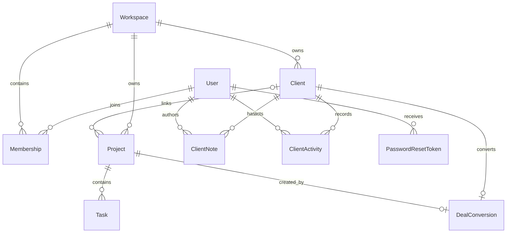

# Route and server-action reference

FlowPilot is one Next.js application, not a standalone public API. Route handlers and server actions are internal application interfaces; buyers should preserve their authentication, validation, workspace scoping, and demo-write guards.

## Route handlers

| Route | Purpose | Access |
|---|---|---|
| `/api/auth/[...nextauth]` | NextAuth login/session flow | Public entry; signed session output |
| `/api/auth/forgot-password` | Request password-reset email | Public, neutral response, rate-limited, demo denied |
| `/api/auth/reset-password` | Complete single-use reset | Public token flow, rate-limited, transactional |
| `/api/register` | Create user and owner workspace | Public, validated and rate-limited |
| `/api/export/[resource]` | Export filtered workspace CSV | Authenticated and workspace-scoped |

## Server actions

- `src/app/dashboard/projects/actions.ts`: project/task create, update, status, archive/delete; authenticated workspace scope and demo-write policy.
- `src/app/dashboard/clients/actions.ts`: client, notes, status, conversion and deletion; authenticated workspace scope, role checks where required, idempotent conversion.
- `src/app/dashboard/settings/actions.ts`: profile/workspace changes; authenticated context, role and demo-write checks.

## Data model summary

`User` joins `Workspace` through `Membership`. A workspace owns `Project` and `Client`; projects own `Task` and may link to a client. `DealConversion` links one won client to one project. Client notes/activity keep author/actor references. Reset tokens belong to users, and shared rate-limit windows are stored in MongoDB.

## Entity relationship diagram

